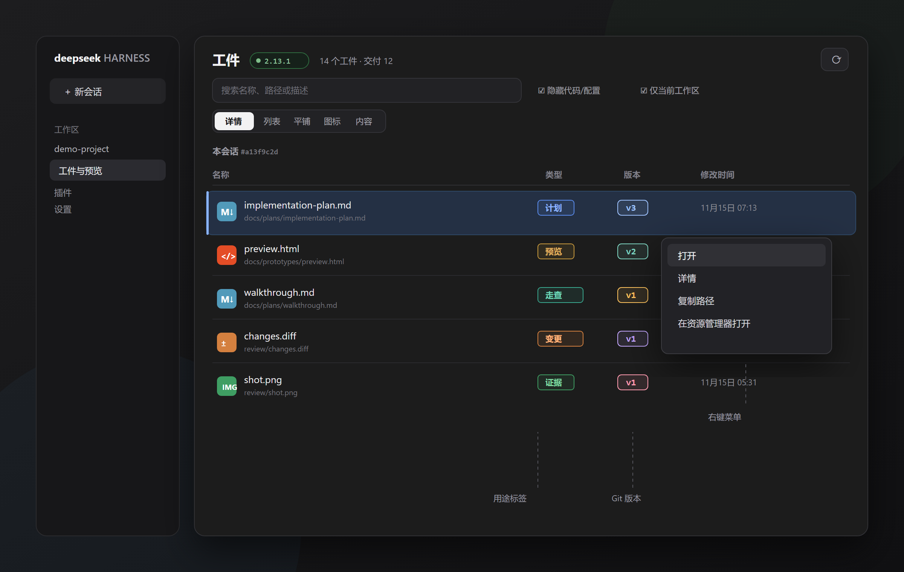
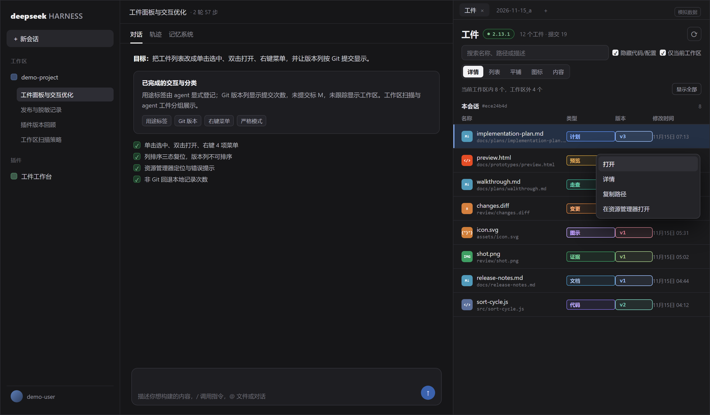

# dsh-agent-artifacts





Agent 工件工作台：把会话里交付/写入的文件、Git 版本与工作区扫描整理成可筛选、可预览的侧栏列表。

适用 DeepSeek Harness（DSH）Web 客户端。

## 功能

- **工件列表**：默认按工件类型分组，可切文件类型或会话；显示类型、版本、修改时间；可切详情/列表/平铺/图标/内容视图。
- **类型管理**：工件类型支持自定义图标与自定义集合（最多 20 个），图标复用 material 图标集。
- **用途标签**：计划、走查、变更、图示、证据、预览、文档、代码、其他、未标注。
  - `register_artifact` / `present` 的显式用途优先；普通 `write/edit` 不猜类型。
- **来源与范围**：交付、写入、扫描、其他会话；默认只看当前工作区。
- **Git 版本**：`vN` 为提交次数；未提交标 `M`，未跟踪显示「工作区」，非 Git 显示 `—`；详情可看旧版。
- **交互**：单击选中、双击打开、右键菜单（打开/详情/复制路径/在资源管理器打开）。
- **列**：类型、版本、归属（默认隐藏）、修改时间；支持拖拽宽度、显示/隐藏/排序。
- **安全**：敏感文件不索引、不预览；Git 只读；资源管理器只做定位。

## 安装

### 从 GitHub 源码安装（推荐）

DSH → 插件 → 安装 → 选择“从源码/URL”，填入：

```text
github:mlgbz511/dsh-agent-artifacts
```

或在目标 profile 目录手动安装：

```bash
pnpm add github:mlgbz511/dsh-agent-artifacts
```

安装后在「设置 → 插件」启用 `dsh-agent-artifacts`，侧栏出现「工件」面板。

### 本地开发

本仓库只发布运行时文件；测试套件与内部设计文档留在私有仓库，不随公开仓库分发。

```bash
git clone https://github.com/mlgbz511/dsh-agent-artifacts.git
cd dsh-agent-artifacts
pnpm link --global   # 或把 profile 的依赖指向本目录
```

## 设置

- **内容范围**：显示其他会话（工作区扫描）、严格模式（只显示显式交付）、隐藏代码/配置。
- **显示排版**：视图模式、字号、路径、归属列、默认排序。
- **文件类型组**：图标、名称、扩展名/特殊文件名分组。
- **工件类型**：启用/隐藏用途标签。

## 数据与权限

- 只读本地会话记录与文件；不写入工件文件。
- 扫描默认关闭；跳过 `.git`、`.dsh`、`.gemini`、node_modules、构建/缓存目录。
- 敏感文件名/扩展名（`.env`、私钥等）不会出现在列表或预览中。
- Git 命令使用 argv 调用，5 秒超时；旧版预览限制 200 KB 文本。

## 开发

```bash
node --check client.js
node --check index.js
npm run verify
npm pack --dry-run
```

测试套件不在公开仓库，`npm run verify` 只校验包内文件。

## 版本

当前 `2.13.1`。发布记录见 GitHub Releases / `v2.13.1` tag。

## 许可证

MIT，见 [LICENSE](LICENSE)。第三方图标与代码声明见 [THIRD-PARTY-NOTICES.md](THIRD-PARTY-NOTICES.md)。
